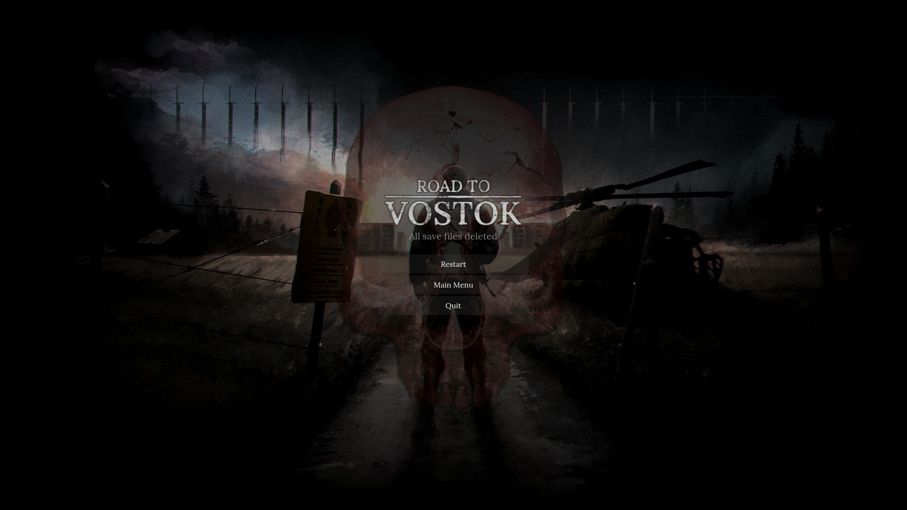

# Vostok Toolkit

A quality-of-life toolkit for **Road to Vostok** — loadout presets, smarter tasks, thermal vision, kill stats, a dynamic killfeed and fast travel, all in one mod.

**Version:** 4.16.1 · **Loader:** Metro Mod Loader 3.4.2 · **Game:** 0.2.1.0 · **Language:** RU / EN

## Features

| Feature | What it does |
|---|---|
| **Loadout Presets** | Save equipment/inventory as a preset and bind it to a hotkey. |
| **Auto-equip** | Items with slots are equipped on pickup (MCM toggle). |
| **Matches stack in equip** | Matches stack right into the equipment slot. |
| **Better Tasks** | Completed-quest auto-cleanup, partial hand-in, Notes icon rows. |
| **Thermal Vision (NVG)** | World heat glow, mine highlighting, friendly Nomad markers. |
| **Kill Stats & Killfeed** | HUD kill/enemy counter and a dynamic killfeed. |
| **Fast Travel** | Move between maps, shelters and traders. |
| **Ironman Restart** | Death-screen Restart button for permadeath runs (+ Apartments map). |

## Installation

1. Install Metro Mod Loader for Road to Vostok.
2. Download `Loadouts.vmz` from [Releases](https://github.com/dgtball/VostokToolKit/releases).
3. Drop it into `Road to Vostok\mods\`.
4. Launch the game.

## Usage

- Toggle panel: `F3` (configurable in MCM).
- Presets live in `user://MCM/vostok-toolkit/VTKsets.json`; interface language in MCM (General → Language).

## Building from source

`Loadouts.vmz` is a zip of the contents of `loadouts/`: `mod.txt` and `mods/` at the archive root (no top-level `loadouts` folder). Zip the folder and rename to `.vmz`, or run `pack.ps1`.

## Repository layout

- `loadouts/mod.txt` — name, id, version, autoload
- `loadouts/mods/VTK/*.gd` — mod source (prefix `VTK`)
- `assets/` — images for the README and the Vostok Mods listing

## Compatibility

Compatible with LateStart. Tested alongside ElegantHUD, JCM and other common mods. Conflicts are unlikely but not impossible.

## Credits

- Juuzoz' Cheat Menu [JCM](https://vostokmods.net/mod/juuzoz-cheat-menu-jcm) by juuzoz_ — the starting point for the loadout idea
- [Thermal Vision](https://www.nexusmods.com/roadtovostok/mods/141) by Vito921 — inspiration for the thermal rework
- [Partial Task Hand-In](https://modworkshop.net/mod/56789) by Ryujiro — inspired partial task hand-in

## Development note

This project is developed with the assistance of generative AI.

## License

[MIT](LICENSE). Community mod, not affiliated with Road to Vostok or its author.
